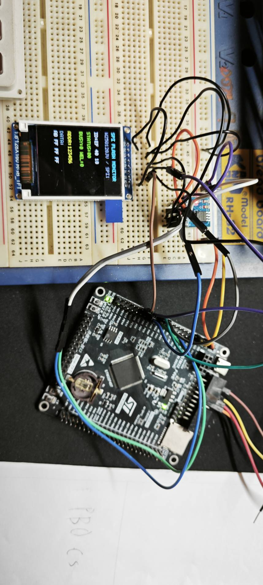

# STM32 SPI Flash Practice

使用 STM32F407VET6 透過 SPI（Serial Peripheral Interface）與外部 Winbond W25Q128JV NOR Flash 進行通訊，練習 Flash 的識別、狀態讀取、寫入控制及記憶體讀寫。

## 1. Hardware / Equipment

| 設備                      | 型號                    | 用途         |
| ----------------------- | --------------------- | ---------- |
| Microcontroller         | STM32F407VET6         | SPI Master |
| SPI NOR Flash           | Winbond W25Q128JV     | 外部資料儲存     |
| Debugger / Programmer   | ST-Link      | 程式燒錄與除錯    |
| Development Environment | STM32CubeIDE / CubeMX | 程式開發與周邊設定  |
LCD螢幕 | ST7735 SPI TFT LCD | 



### Flash Specifications

- Capacity：128 Mbit（16 MiB）
- Interface：SPI
- Operating Voltage：2.7–3.6 V
- Page Size：256 bytes
- Sector Size：4 KB
- Address Range：`0x000000` ～ `0xFFFFFF`

## 2. Wiring / SPI Connection

STM32 作為 SPI Master，W25Q128JV 作為 SPI Slave。

以下為 STM32F407 常見的 SPI1 腳位配置，實際接線需與 CubeMX 設定核對。

| Flash Pin | STM32 Pin | 功能                      |
| --------- | -------------- | ----------------------- |
| VCC       | 3.3V           | 電源                      |
| GND       | GND            | 共地                      |
| CS        | PA4            | Chip Select（Active Low） |
| CLK / SLK | PA5            | SPI Clock（SCK）          |
| DO / D0   | PA6            | MISO（Flash → STM32）     |
| DI / D1   | PA7            | MOSI（STM32 → Flash）     |

注意事項：

- Flash 使用 3.3V，不可直接接入 5V。
- CS 拉低時選取 Flash，拉高時結束交易。
- SPI Master 負責產生 Clock。
- 若模組還有 WP、HOLD 等腳位，需依模組設計正確處理。

## 3. SPI Communication

SPI 使用同步全雙工通訊。

每產生一個 Clock，MOSI 和 MISO 都會同步傳輸一個 bit。

本專案主要使用 STM32 HAL Library：

```c
HAL_SPI_Transmit();
HAL_SPI_Receive();
HAL_SPI_TransmitReceive();
```

例如：

```c
HAL_SPI_Transmit(&hspi1, &command, 1, 1000);
HAL_SPI_Receive(&hspi1, data, 3, 1000);
```

傳送指令後，Flash 會依照指令回傳對應資料。

在 Master 全雙工模式下，接收資料仍然需要產生 Clock。

## 4. Implemented Features / Learning Progress

### 4.1 Read JEDEC ID — `0x9F`

透過 SPI 讀取 Flash 的 JEDEC ID，以確認裝置識別資訊。

預期結果：

| Byte | Value  | Meaning              |
| ---- | ------ | -------------------- |
| 0    | `0xEF` | Manufacturer：Winbond |
| 1    | `0x40` | Memory Type          |
| 2    | `0x18` | Capacity：128 Mbit    |

### 4.2 Read Status Register-1 — `0x05`

讀取 Flash 狀態暫存器。

主要檢查：

| Bit | Name | Description        |
| --- | ---- | ------------------ |
| 0   | BUSY | Flash 是否正在執行內部操作   |
| 1   | WEL  | Write Enable Latch |

使用 Bitwise Operations 解析：

```c
uint8_t busy = status_reg & 0x01;
uint8_t wel  = (status_reg >> 1) & 0x01;
```

### 4.3 Toggle Write Enable Latch

透過以下指令控制 WEL：

| Command | Instruction   | Function |
| ------- | ------------- | -------- |
| `0x06`  | Write Enable  | WEL = 1  |
| `0x04`  | Write Disable | WEL = 0  |

測試流程：

1. Read Status Register
2. Write Enable
3. Read Status Register，檢查 WEL = 1
4. Write Disable
5. Read Status Register，檢查 WEL = 0

### 4.4 Read Data — `0x03`

從指定的 24-bit Address 讀取 Flash 資料。

SPI 傳輸格式：

```text
[0x03] [A23:A16] [A15:A8] [A7:A0] [Data...]
```

例如從 `0x000100` 開始讀取：

```c
uint8_t command[4] = {
    0x03, 0x00, 0x01, 0x00
};
```

Flash 會依序回傳指定位置的資料，並自動遞增讀取位址。

### 4.5 Page Program — `0x02`

將資料寫入指定 Flash 位址。

基本流程：

1. 確認目標區域已擦除。
2. Write Enable（`0x06`）。
3. Page Program（`0x02`）。
4. 等待 BUSY = 0。
5. Read Data（`0x03`）驗證寫入結果。

寫入格式：

```text
[0x02] [A23:A16] [A15:A8] [A7:A0] [Data...]
```

注意：

- 單次 Page Program 不可跨越 256-byte Page 邊界。
- NOR Flash 寫入通常只能將 bit 從 1 改成 0。
- 恢復成 1 需要先進行 Erase。

## 5. Overall Program Flow

```text
STM32 Startup
      |
      v
HAL Initialization
      |
      v
GPIO / SPI Initialization
      |
      v
CS = LOW
      |
      v
Send SPI Command
      |
      v
Transmit / Receive Data
      |
      v
CS = HIGH
      |
      v
Check HAL Status
      |
      v
Process / Verify Result
```

Flash Write Flow：

```text
Check Target Address
         |
         v
Erase Sector (if required)
         |
         v
Write Enable (0x06)
         |
         v
Page Program (0x02)
         |
         v
Wait Until BUSY = 0
         |
         v
Read Back (0x03)
         |
         v
Compare Written / Read Data
```
